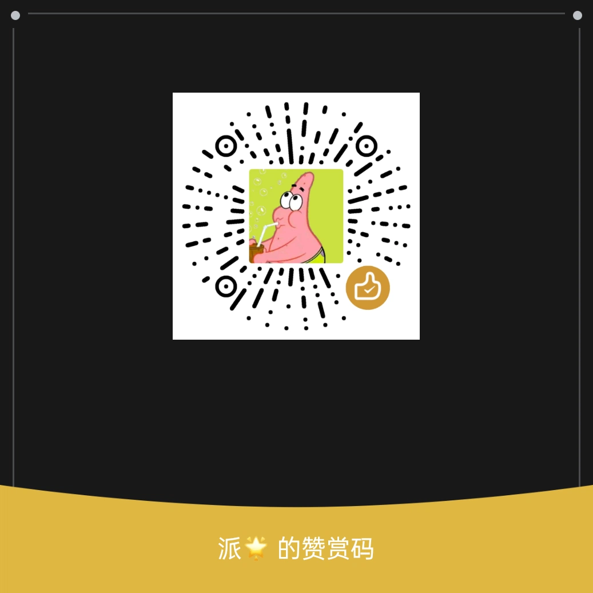

# -AI-QQ- 🤖

一台安卓手机同时跑起 **QQ + 微信 AI 机器人**，支持多家大模型，自带开机自启和进程守护。

> QQ 通道支持文字、图片、视频、联网搜索；微信基于 OpenClaw（龙虾）框架。
> **QQ 和微信互相独立，可以只用 QQ、只用微信，或者两个都用。**

---

## 📥 下载

前往 [Releases 页面](https://github.com/cbh13458-creator/-AI-QQ-/releases) 下载发布包：

| 版本 | 下载 | 说明 |
|------|------|------|
| 🟢 普通版 | [android-bot-normal.zip](https://github.com/cbh13458-creator/-AI-QQ-/releases/latest/download/android-bot-normal.zip) | 多 AI 厂家 + 一键部署 + 开机自启 |
| 🔴 Pro 版 | [android-bot-pro.zip](https://github.com/cbh13458-creator/-AI-QQ-/releases/latest/download/android-bot-pro.zip) | 在普通版基础上增加：一次性激活密钥、进程守护、健康检查、日志轮转、内存限制 |

---

## 📦 包里有什么

```
├── apk/                    # Termux 三件套安装包
│   ├── Termux-v0.118.3-arm64.apk
│   ├── Termux-API_v0.53.0_github-debug.apk
│   └── TermuxBoot-v0.8.1.apk
├── qq-bot/                 # QQ 机器人源码
│   ├── main.py / ai.py / config.py
│   ├── requirements.txt
│   └── .env.example        # AI 配置模板
├── setup.sh                # 一键安装脚本
├── bot.sh                  # 启停 / 状态管理
├── boot-start.sh           # 开机自启
└── (Pro 版额外) activate.sh / watchdog.sh / health-check.sh / keys.dat
```

---

## 🎯 三种使用方式

QQ 和微信是两个独立进程，**想用哪个就启动哪个**，不强制同时用。

### 方式一：QQ + 微信都用（默认）

1. 填好 `qq-bot/.env` 里的 QQ 凭证
2. 绑定微信：`openclaw channels login --channel openclaw-weixin`
3. 启动：

```bash
bash ~/bot.sh start        # 两个一起启动
```

### 方式二：只用 QQ（不需要微信）

1. 填好 `qq-bot/.env` 里的 QQ 凭证
2. **不要**执行 `openclaw channels login`（不绑微信就行）
3. 启动：

```bash
bash ~/bot.sh start-qq     # 只启动 QQ
```

> 微信那边的 openclaw 网关即使跑着也没关系，没绑微信账号就不会工作。

### 方式三：只用微信（不需要 QQ）

1. 绑定微信：`openclaw channels login --channel openclaw-weixin`
2. `qq-bot/.env` 里的 QQ 凭证**可以不填**（QQ 机器人没凭证会自动退出）
3. 启动：

```bash
bash ~/bot.sh start-oc     # 只启动微信
```

---

## 🚀 完整安装步骤

### 1. 安装 APK

把 `apk/` 里的三个 APK 都装上：
- **Termux** — 终端环境
- **Termux:API** — 让 Termux 调用安卓系统能力
- **Termux:Boot** — 开机自启

### 2. 激活开机广播

打开一次 **Termux:Boot** App（打开就行，不用操作），然后把它从后台划掉。

### 3. 拷贝文件到 Termux

把解压后的所有文件（`qq-bot/`、`setup.sh`、`bot.sh`、`boot-start.sh` 等）拷贝到 Termux 的家目录：

```bash
# 假设文件在手机下载目录
cp -r /sdcard/Download/android-bot/* ~/
```

### 4. 运行安装脚本

```bash
bash ~/setup.sh
```

按提示填写：
- QQ 机器人凭证（AppID、Token 等）
- 选择 AI 厂家并填写 API Key

### 5. 绑定微信（只用 QQ 的可跳过）

```bash
openclaw channels login --channel openclaw-weixin
```

扫码登录微信。

### 6. 启动机器人

```bash
bash ~/bot.sh start        # QQ + 微信
# 或
bash ~/bot.sh start-qq     # 只用 QQ
# 或
bash ~/bot.sh start-oc     # 只用微信
```

---

## 🔴 Pro 版额外步骤：激活

Pro 版**必须先激活才能启动**（密钥一用即废，绑定设备）：

```bash
bash ~/activate.sh
```

输入你拿到的激活密钥（格式 `ABOT-XXXX-XXXX-XXXX`，向作者单独获取）。

激活成功后会生成设备绑定凭证，以后开机自动识别，无需重复激活。

---

## 🎮 日常管理命令

```bash
bash ~/bot.sh start        # 启动 QQ + 微信
bash ~/bot.sh start-qq     # 只启动 QQ
bash ~/bot.sh start-oc     # 只启动微信
bash ~/bot.sh status       # 查看运行状态
bash ~/bot.sh stop         # 停止全部
bash ~/bot.sh stop-qq      # 只停止 QQ
bash ~/bot.sh stop-oc      # 只停止微信
bash ~/bot.sh              # 进入菜单（可视化操作）
```

Pro 版额外命令：

```bash
bash ~/watchdog.sh &       # 启动进程守护（进程挂了自动拉起，每 30 秒检查）
bash ~/health-check.sh     # 一键健康检查（进程 / 网关端口 / 微信渠道）
bash ~/activate.sh         # 激活（仅需一次）
```

---

## 🧠 AI 厂家配置

编辑 `qq-bot/.env`，支持以下厂家：

| 厂家 | 说明 |
|------|------|
| 智谱 AI | `ZHIPU_API_KEY` |
| OpenAI | `OPENAI_API_KEY` + `OPENAI_BASE_URL` |
| DeepSeek | `DEEPSEEK_API_KEY` |
| 自定义 | 任意兼容 OpenAI 协议的接口，填 `BASE_URL` + `API_KEY` + `MODEL` |

详见 `qq-bot/.env.example`。

---

## ⚙️ 开机自启设置

在手机「设置」里给 Termux 放行：
1. **自启动权限** → 允许
2. **耗电保护 / 电池优化** → 设为「无限制」或关闭优化
3. 锁屏后保持后台运行

重启手机后会自动拉起机器人。Pro 版会等网络就绪再启动，失败自动重试。

> **只想开机自启某一个？** 编辑 `~/.termux/boot/start.sh`，把 `bash "$HOME/bot.sh" start` 改成 `start-qq`（只启 QQ）或 `start-oc`（只启微信）。

---

## 🔴 Pro 版 vs 🟢 普通版

| 功能 | 普通版 | Pro 版 |
|------|:------:|:------:|
| 多 AI 厂家 | ✅ | ✅ |
| QQ + 微信双通道（可单用） | ✅ | ✅ |
| 一键安装 / 开机自启 | ✅ | ✅ |
| 一次性激活密钥（设备绑定） | ❌ | ✅ |
| 进程守护（挂了自动拉） | ❌ | ✅ |
| 健康检查脚本 | ❌ | ✅ |
| 日志自动轮转（防无限增长） | ❌ | ✅ |
| Node 内存限制（防 OOM） | ❌ | ✅ |
| 随机网关密钥固化 | ❌ | ✅ |

---

## 💰 获取 Pro 激活码

Pro 版通过**赞赏激活**的方式获取激活密钥：

1. 扫描下方赞赏码，赞赏 **9.9 元**
2. 在赞赏**备注里填写你的微信号**
3. 作者看到后会通过微信把激活码发给你

> Pro 版激活码格式为 `ABOT-XXXX-XXXX-XXXX`，一次性使用、绑定首次激活的设备。

<p align="center">
  
</p>

---

## ⚠️ 注意事项

- 发布包内**不包含任何真实 API Key 或 QQ 凭证**，全部为占位符，需自行填写。
- Pro 版激活密钥**不随包分发**，需向作者单独获取。
- 首次运行建议用 `bash ~/bot.sh start` 看日志确认正常，再开 watchdog。
- 微信登录后不要主动退出微信账号，否则需要重新扫码。
- QQ 和微信可独立使用，不需要的那个不配置、不启动即可。

---

## ❓ 常见问题

**Q: 我只想用 QQ，微信那边会出问题吗？**
A: 不会。不执行 `openclaw channels login` 就不会绑微信，用 `bash ~/bot.sh start-qq` 只启动 QQ 即可。

**Q: 我只想用微信，QQ 凭证不填行不行？**
A: 行。QQ 机器人检测到没凭证会自动退出，不影响微信。用 `bash ~/bot.sh start-oc` 只启动微信。

**Q: 微信登不上 / 龙虾渠道异常？**
A: 运行 `bash ~/health-check.sh`（Pro 版）或手动检查 `openclaw status`，确认网关端口和渠道状态。

**Q: 手机重启后机器人没起来？**
A: 检查 Termux 的自启动权限和电池优化是否放行，再打开一次 Termux:Boot App。

**Q: Pro 版密钥提示已使用？**
A: 密钥是一次性的，绑定到首次激活的设备。换设备需重新获取密钥。

---

**项目地址**：https://github.com/cbh13458-creator/-AI-QQ-
